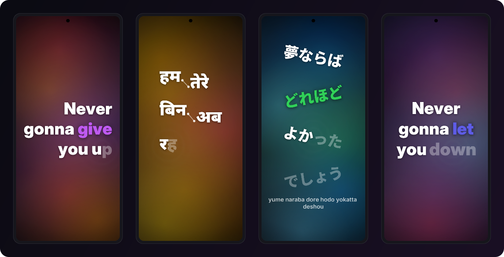
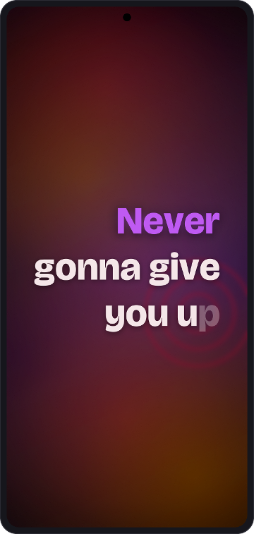
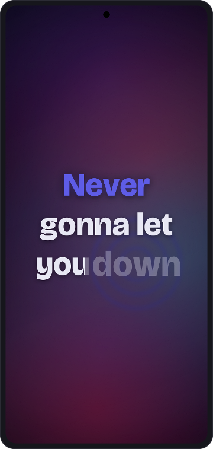
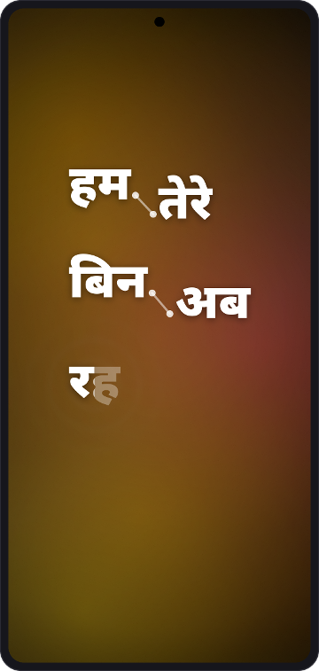
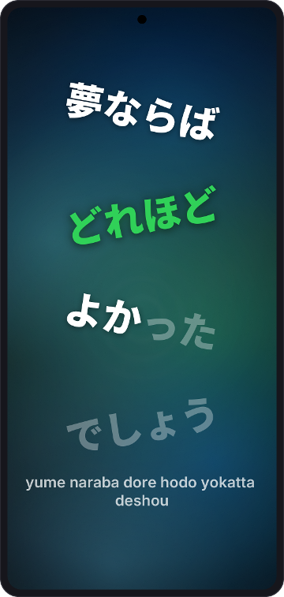
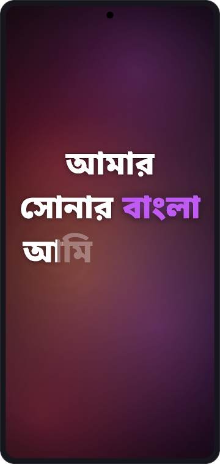
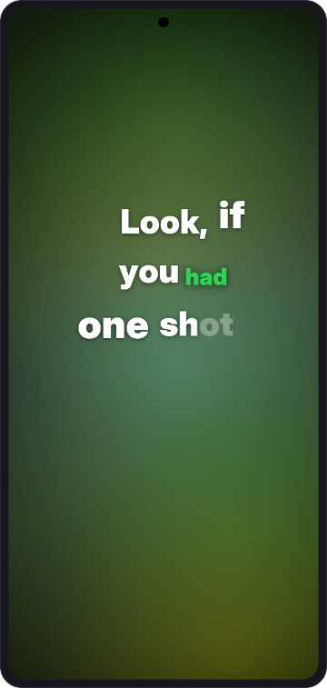
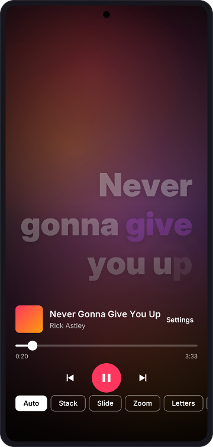

# LyricStage

LyricStage shows word-synced lyrics for whatever is playing on your Android phone. It works with Spotify, YouTube Music, Apple Music and any other player that publishes a media session. Each line is set in large type and animated word by word in time with the song.



**[Download the latest release](https://github.com/Saptarshi-Nag189/lyric-stage/releases/latest)** (APK, Android 10 or later)

## Features

- Follows the active player through Android's media sessions. No account and no player integration needed.
- Seven layouts: Stack, Slide, Zoom, Letters, Scatter, Graph and Flow. The app picks one per line from how fast it is sung, how long it is and whether it repeats as a chorus, and never uses the same one twice in a row. You can lock a favourite.
- Words fill from left to right while they are sung. One to three words per line take a colour from the album art.
- Lyrics come from [LRCLIB](https://lrclib.net) and are cached on the phone. Missing lyrics are retried every minute while the song plays.
- Uses per-word timings when the lyrics have them (enhanced LRC). Otherwise it estimates them from syllables, or from aksharas for Hindi and Bengali.
- Shows a romanised line under Japanese, Hindi or Bengali lyrics when the lyrics file includes one.
- On Android 13 and later the background is a moving "liquid glass" shader in the artwork's colours, with a ripple from each sung word. Older phones get an animated gradient. Artwork blur and a plain colour are also available.
- Every line is fitted to the screen before it is shown, so words are never cut off, in portrait or landscape.
- A reduce motion setting replaces the animation with fades. It turns on by itself when system animations are off.

## Screenshots

| Stack | Zoom | Graph |
|:---:|:---:|:---:|
|  |  |  |
| **Flow** | **Letters** | **Scatter** |
|  |  |  |

<p align="center"></p>

Tap the stage to show the controls for three seconds: seek bar, play and pause, skip and the layout picker. The lyrics fade back while the controls are open.

The images above are drawn by the app's own layout engine (`core`) with the bundled fonts. The background is an approximation of the shader. The lyric lines are short excerpts quoted to show the layouts: Rick Astley, "Never Gonna Give You Up"; Arijit Singh, "Tum Hi Ho"; Kenshi Yonezu, "Lemon"; Rabindranath Tagore, "Amar Shonar Bangla"; Eminem, "Lose Yourself". `tools/screenshots/render.sh` regenerates them.

## Install

1. Download `LyricStage-vX.Y.Z.apk` from the [releases page](https://github.com/Saptarshi-Nag189/lyric-stage/releases) and open it on your phone.
2. Open LyricStage and tap "Open notification access". Turn LyricStage on in the list and go back.
3. Play a song in any music app.

Google Play Protect may block the install with "App blocked to protect your device". It does this for any app installed from outside the Play Store that asks for notification access. LyricStage needs that access because it is the only way Android lets an app see what other players are playing. The app only reads media sessions and never reads your notifications.

To install anyway, open the Play Store, tap your profile picture, then Play Protect, then the settings gear, and turn off "Scan apps with Play Protect". Install the APK, then turn scanning back on. Installing over USB or wireless debugging with `adb install` also works.

Releases are currently signed with a temporary key, so uninstall the previous version before installing a new one.

## Using it

- Tap the stage to show or hide the controls.
- Long-press the stage to lock the current layout. Long-press again to go back to automatic.
- If the words run early or late, open Settings and use the sync buttons under "This song". Each tap moves the lyrics by 250 ms, and the setting is saved for that song.
- If LRCLIB has no lyrics for a song, use "Import .lrc" on the stage or under "This song" in Settings to pick a file from the phone. It is saved for that song.
- Songs with lyrics but no timings scroll slowly with the song and are labelled as unsynced.
- Settings also has the layout lock, background style, text size, highlight strength and reduce motion. Debug screens there show the player's raw and smoothed position, the fetched lyrics, and FitCheck, which lays out every cached line in every layout and lists any word that would be cut off.

## Privacy

The app's only network request is the lyrics lookup on lrclib.net, which sends the song title, artist, album and length. There are no accounts, analytics or ads. Lyrics and sync settings are stored on the phone and excluded from backups.

## Building

You need JDK 17 or later and the Android SDK with platform 36.

```
./gradlew assembleDebug          # app/build/outputs/apk/debug/app-debug.apk
./gradlew -PcoreOnly :core:test  # core module only; no Android SDK needed
```

Every push runs the core tests, a debug build and Android lint on GitHub Actions. Lint errors fail the build. Each run attaches the debug APK as the `lyricstage-debug-apk` artifact.

## Project layout

```
core/   Plain Kotlin, unit tested on the JVM
  lyrics/   LRC parsing, word timing estimates, LRCLIB client, title cleanup, track keys
  clock/    Playback clock: extrapolates between position reports, eases drift under 300 ms, snaps on seeks
  palette/  Colour maths: dark base, vivid accents, text contrast of at least 7:1
  stage/    Layout geometry and motion for the seven layouts, FitEngine, layout chooser, highlights
  text/     Script detection, grapheme clusters (Indic conjuncts kept whole), tokenizer
app/    Android app (Kotlin, Jetpack Compose)
  media/      Notification listener and active session tracking
  lyrics/     Repository with Room cache, retries and .lrc import
  stage/      Stage composable, frame loop, renderer, fonts
  background/ Liquid glass AGSL shader, ripples and fallbacks
  ui/         Stage screen, controls, settings, onboarding, debug screens
tools/screenshots/  Renders the README images with the core layout engine
```

Layout and timing live in `core` so they can be tested without a device. `FitCheckTest` lays out every sample line in every layout at four screen sizes and three text sizes, about 7,300 layouts, and fails if any word leaves the safe area.

The stage runs one frame loop that reads the clock once per frame. Two canvas passes draw the line: one for settled words, and one for fast-moving words under a blur layer on Android 12 and later. Text layouts are measured once when lyrics load or the screen size changes, so nothing recomposes per frame. Entrances use a closed-form spring evaluated from elapsed time, so seeking redraws the right frame, and settled text is drawn at exactly scale 1 with no blur.

## Releases

To publish a release, change the number in `VERSION`, add a matching section to `CHANGELOG.md` and push. `.github/workflows/release.yml` then builds a release APK and publishes it as a GitHub Release tagged `vX.Y.Z`, with `SHA256SUMS.txt` and that changelog section as the notes.

The workflow signs with your own key when these repository secrets are set: `LYRICSTAGE_KEYSTORE_BASE64`, `LYRICSTAGE_KEYSTORE_PASSWORD`, `LYRICSTAGE_KEY_ALIAS` and `LYRICSTAGE_KEY_PASSWORD`. Without them it falls back to a temporary key.

## Credits

The layout set, layout chooser, word timing estimates, clock smoothing and the liquid glass background are based on ideas from [LyricalStudio](https://github.com/arijit-debug/LyricalStudio) (MIT). LyricStage is a separate Kotlin implementation; see `ref/CREDITS.md` for the licence.

Lyrics come from [LRCLIB](https://lrclib.net). Inter, Noto Sans Devanagari, Noto Sans Bengali and Noto Sans JP are bundled under the SIL Open Font License 1.1 (`app/src/main/assets/licences/OFL.txt`).
